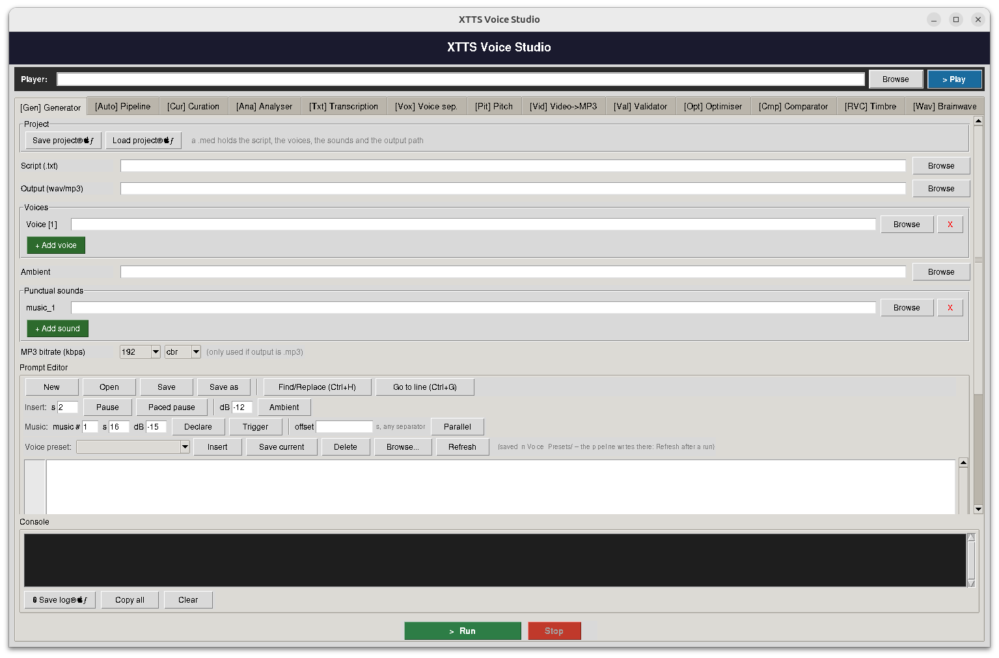

# XTTS Voice Studio

A complete toolkit for voice cloning, guided meditation generation, audio analysis, parameter validation and automated optimisation — built around Coqui XTTS v2 with a unified Tkinter GUI.

  

---

## Overview

XTTS Voice Studio is a personal production suite for:

- **Cloning voices** from short audio samples via XTTS v2
- **Generating guided meditations** with multi-voice narration, ambient music and punctual sound cues
- **Analysing voices** acoustically (Praat + librosa) to derive optimal XTTS parameters automatically
- **Validating parameters** empirically by generating and comparing audio variations
- **Comparing clones** to their reference voice spectrally and optimising audio parameters automatically via iterative feedback
- **Transcribing** audio and video to XTTS-ready scripts
- **Separating voices** from mixed audio sources — by pitch, by speaker
  embedding against solo examples of each person, or with SepFormer / pyannote
- **Converting video** to audio in various formats
- **Generating binaural, isochronic and monaural beats** and physically modelled
  singing bowls, as multi-segment sessions with per-mode control — see
  [BRAINWAVE.md](BRAINWAVE.md)

Every tool is accessible through a single Tkinter interface (`xtts_studio.py`) or directly from the command line.



---

## What's new

**3.7.5 — a small reverb renders**

- The generator rounds the reverb's three echo decays to two decimals, and
  FFmpeg's `aecho` refuses a decay of 0: any `reverb` below 0.028 failed with
  "Reverb error" and the voice came out dry. The five failed trials of a real
  audio search were all such values. The decays now stop at 0.01, an echo
  40 dB down; from 0.028 on, the filter is the same as before. 302 tests.

**3.7.4 — a review of 3.7.3 (ChatGPT): one adoption bar, budgets checked first**

- The audio search adopts a block on the same bar with or without
  `--screen-audio`: a mean gain above both 0.02 and twice the measured
  tolerance. In 3.7.3 the diagnostic changed the decision: with it the bar was
  twice its tolerance, which could fall to 0.008; without it, 0.02 whatever the
  tolerance.
- The pipeline and both tabs check the budget of the search before starting
  (68 evaluations at most with every field and no target level): a budget too
  small for `--search-all-fields` used to stop the pipeline only at the tone
  fit, after the curation, the analysis and the optimiser.
- **Include speed, pan and limiter** in [Auto] and [Cmp] does what
  `--search-all-fields` does. The budget check now also holds at an EQ limit
  of exactly 0.5 dB, where it counted 3 trials too few. 300 tests.

**3.7.3 — the search of every `[]` field (ChatGPT), pruned and held**

- From ChatGPT's version built on 3.7.2: `--optimise-audio` tries each field of
  `[]` on its own, effects that are off included (hp, lp and the gate have a
  real off state), then searches them jointly against ECAPA identity. A
  candidate is adopted only if it gains on two other sentences, whose renders
  are kept with a JSON audit; with `--target-dbfs` the level is measured after
  the effects; an effect that fails is no longer scored as a trial.
- The block is adopted as a whole, so a field that does nothing kept whatever
  value the optimiser left it at. With a simulated ECAPA where only `eq_mid`
  mattered, through the real search and adoption rule, every adopted block
  also moved the speed (from 0.9 to anywhere in 0.76–1.23), the pan (up to
  0.96), the reverb and the NR. A **pruning** pass now sends each change back
  to its starting value unless that costs more than the heuristic tolerance,
  one tolerance in all: `eq_mid` alone changes, its gain is kept.
- **Speed, pan and limiter are held** (`--search-all-fields` frees them): the
  speed is the meditation's pace, which ECAPA does not measure; ECAPA averages
  both channels, so pan is only a gain to it; the limiter protects against
  clipping.
- The search is **off by default** in the pipeline and both tabs: hundreds of
  renders (1.25–1.6 s each for 8 s of voice on two CPU cores, two per trial at
  a target level) whose result has to be heard. A failed search keeps the tone
  fit and the pipeline goes on; the recap names it. 288 tests.

**3.7.2 — the Comparator compares smoothed spectra; a review of 3.7.1 merged**

- Below about 1 kHz a voice's long-term spectrum is a comb: the harmonics of
  F0 with hollows between them, and where the teeth fall depends on the melody
  of the sentence, which a clone never repeats. The **Comparator** compared the
  spectra point by point, so the teeth made most of its error, no EQ could
  reduce it, and the fit was pulled the wrong way: on a real 16 kHz reference
  it raised `eq_low` by 1.9 dB on a clone that already had 15 points too much
  energy below 300 Hz. It now compares the mean power over bands of 250 Hz
  (one harmonic spacing) or a third of an octave above 1.1 kHz, and fits the
  EQ on the render's own spectrum with the bells' exact responses, so its
  prediction holds to 0.02 dB through the real chain. On synthetic voices
  through that chain, a clone of the same voice with another intonation keeps
  its energy below 300 Hz at the reference's 27 %, where 3.7.1 took it to 42 %;
  one with a 4 dB too strong fundamental goes from 45 % to 32 %, where 3.7.1
  took it to 53 %.
- From a review of 3.7.1 (ChatGPT): the [Cmp] tab runs 3 passes and names its
  threshold right (an EQ/volume change, not a score delta); a C6 confirmation
  cut by the budget keeps the base; French numbers count the same in digits
  and in words in the WER (« 48 » = « quarante-huit », a different number still
  counts); the result JSON records how it was scored. Two of its changes are
  redone: a language mismatch now stops a run only when the command and the
  `[]` both name a language (and a `[]` without one no longer imposes FR),
  and a take whose timbre cannot be measured counts with the worst timbre
  instead of stopping the whole search. 259 tests.

**3.7.1 — the low-pass is a treble tilt; the Comparator can switch it off**

- At the 24 kHz of an XTTS render, the generator's low-pass (pydub, first
  order) is not a cut above `lp` but a tilt of the whole upper band: lp 9000
  takes 2.1 dB at 4 kHz and 4.5 dB at 8 kHz, and lp 16000 still 2.8 dB at
  8 kHz. The **Analyser** wrote 7000 to 9000 Hz by voice type; it now leaves
  `lp` at 0 (off).
- The **Comparator**'s first pass weighs the low-pass off against the block's
  own filters with their exact responses: the EQ is fitted on the curve the
  filters will give, the error it leaves is predicted, and the render decides,
  as for any change. It used to open the low-pass by 1000 Hz and let `eq_high`
  give back the rest, up to its bound. On synthetic voices through the
  generator's own chain, a clone that only the filter made dull ends at 0.68 dB
  of shape error instead of 0.96, with `eq_high` at −0.2 instead of +1.9; a
  block pasted back with `eq_high` +4 lets the boost go (0.68 instead of 1.00);
  a clone with too much treble keeps its low-pass.
- `--optimise-audio` holds a filter that is off, and `vol` under
  `--target-dbfs`; `--screen-audio` and `--fit-identity` try the low-pass off;
  `--fit-identity` with `--no-fit-dynamics` no longer stops on a NameError.
  Presets keep their values, and the Comparator proposes the change on its next
  run. 230 tests.

**3.7 — the conditioning search decides on fresh seeds**

- **C6 confirmation.** The conditioning stages C0 to C5 still screen one render
  per candidate, but what they adopt now only steers the next stages. Their
  winner and the best other screened candidates, 3 in all, are rendered again
  on the noise probe's 4 seeds and compared with the base on those seeds, mean
  against mean, with a one-sided Student t bar corrected for the number of
  candidates. The base's renders there are the probe's own and cost nothing. A
  candidate replaces the analyser's values only beyond that bar; a screening
  winner that fresh seeds do not confirm is named in the log and the recap.
- In a simulation of a real run's configuration (52 s reference, four GPT
  lengths, four reference caps, a spread of 0.03 per render), a real gain of
  +0.06 on chunk 8 is found in 82 % of the runs instead of 52 %, and on the
  single pair gcl 20 s / chunk 8, where that run's best draws were, in 51 %
  instead of 20 %, with 41 renders instead of 89. With no real effect, 3.6.1
  ended on another GPT setting in 33 % of these runs, 3.7 in 2.5 %. A gain of
  +0.02 is found in 4 to 11 % of the runs: for that spread, gains that small
  stay out of reach, and the base is then the honest result.
- **C5 is capped** at its 8 nearest new combinations (87 single draws on a real
  run, none adopted), changes of the GPT settings before changes of the
  reference cap, and it never takes the renders C6 needs: a budget below the
  plan cuts C5 first. Plans: 34 for the pipeline's default fields (21 before),
  46 for a 45 s reference with three GPT lengths and three caps (53), 48 for a
  52 s one with four of each (93). `--cond-budget` defaults to 34 in the
  optimiser, the pipeline and both tabs.
- The result JSON gains `conditioning_confirmation`; `--adopt-alpha 1` still
  reproduces the old "any gain wins", without C6. 213 tests.

**3.6.1 — a seed chosen in the Validator reproduces in the script**

- The **Validator** renders the text exactly as the generator does (final
  punctuation and pitch marks removed). It rendered the raw text, so the same
  sentence and seed gave another take in the script.
- A short **`{}` block** takes the missing fields from its own voice: `{1, 17}`
  before a sentence changes only its seed. With several voices, `{2, 17}` used to
  take the settings of the voice in use. Inside **`[parallel]`**, the `{}` written
  before each `[]` were discarded; they now apply. 189 tests.

**3.6 — timbre on voiced frames, a hold-out that names its failures, EQ headroom**

- The **timbre** term of `both` and `timbre` is measured on the voiced frames
  only, each weighted by its voicing probability, with Praat's HNR. Averaged
  over the whole file, it followed the pauses and consonants of each render and
  carried 86 % of the score's draw-to-draw noise in a real run. On a simulation
  where seeds only move pauses and breaths around real speech, the adoption bar
  falls from 0.034 to 0.016, and a 4 dB brightness change goes from 0.3 to 1.2
  times the bar.
- The **hold-out** reports each unseen sentence (scores, what Whisper heard,
  in which language), flags one that failed, and keeps the renders next to the
  clone (`*_pipeline_clone_holdout1.wav`). In a real run the mean accent of
  the two unseen sentences fell from 0.946 to 0.495 (most likely one of them
  failed), and the old report said "no large score drop".
- A boosting **EQ** no longer clamps peaks that the volume step would have
  brought back under full scale (on a real fit, the loudest peaks were clamped
  at −0.1 dBFS, then lowered to −2.1 dBFS).
- [Auto] tab: **auto all** runs every auto in dependency order; search and
  unseen **sentence files**; a seed like `160180` is flagged as a missing
  space; Stop says Stopped. Identical renders are recognised (`= same audio
  as`), and the analyser's meditation-pace line tells the truth. 182 tests.

**3.5 — priority, tone-fit A/B and production level in the [Auto] tab**

- A **Priority** menu sets w_acc, w_id and Objective together: Resemblance
  (0.3 / 0.7, `both`), the tab's default, or Balanced (0.6 / 0.4, `identity`).
  A field edited by hand shows Custom. What to maximise is a choice: no score
  can make it.
- **EQ weighting `a+blend`**, the tab's default, fits the same clone twice and
  writes both renders, `*_pipeline_clone.wav` and `*_pipeline_clone_blend.wav`,
  with the command for a blind A/B and a second preset `<name> blend`. The
  second fit reuses the first one's raw clone and reference stretch, so only
  the weighting differs, and it loads no model.
- **Target dBFS −20** by default in the tab: every voice at one production
  level. An empty field still matches each reference.
- **gcl s** sits with the other conditioning lengths, with an auto button: from
  20 s up to what XTTS reads of the shortest file. 150 regression tests.

**3.4 — safe budgets in the [Auto] tab**

- An **auto** button next to Budget, Conditioning budget, Chunk lengths, Max
  reference s and Reference lengths to test computes the value from the
  optimiser's own schedule (`search_plan.py`, shared with `xtts_optimize.py`):
  a budget that runs the whole plan, a Max reference s that reads all the
  audio XTTS gets. Before a run, the tab warns when a budget would cut its plan.
- **Re-curate** passes `--recurate`, and the voice readout says when an
  existing `<ref>_curated.wav` will be reused, which leaves Keep s without
  effect. The Keep s auto button only lowers the value now.
- The curated file is exactly Keep s long. It used to come out 10 ms per join
  short for even values (29.95 s for 30), which started the search at
  `gpt_cond_len` 29.
- The optimiser prints its conditioning plan next to its sampling plan. 141
  regression tests.

**3.3 — render chain and search statistics**

- The limiter now runs **last**, after speed and volume, and shares one
  floating-point pass with the volume: a positive `vol` is limited instead of
  clipped, and an EQ boost that reaches full scale is limited instead of
  clipping inside the EQ stage. Every tool renders through the same
  `render_voice_chain()`, so what is measured is what is rendered.
- The optimiser adopts a setting only when its gain beats the **measured**
  draw-to-draw noise (`--adopt-alpha`), prints its plan size up front, and says
  when a budget cuts a stage short.

**3.2.1 — settings, search and separation**

- 17-field `{}` block (`num_beams`, `do_sample`, `max_ref_len`); seed `0` is a
  real seed and the seed is re-applied for every sentence.
- Conditioning search (reference cap, GPT length, chunk, normalisation,
  reference subsets) before the sampling search; machine-readable result JSON.
- The Comparator fits against the stretch of the reference that says the same
  words, models the EQ at the clone's sample rate, bounds the cumulative gains
  and keeps a pass only if the rendered spectrum improves.
- Voice separation with solo references, a review output for undecided or
  overlapping speech, and no overwriting of earlier results.
- Input validation throughout and 127 regression tests (with 3.3).

Details, measurements and upgrade notes: **[CHANGELOG.md](CHANGELOG.md)**.

---

## Installation

### The short way

```bash
git clone https://github.com/ZFEbHVUE/XTTS-Voice-Studio
cd XTTS-Voice-Studio
./install.sh
```

Creates the conda environment, installs the pinned dependencies, checks the
system tools pip cannot provide, and adds a launcher to the applications menu
and the desktop. `--cpu` for a CPU-only torch, `--no-icon` to skip the launcher.
Running it twice is safe: an existing environment is reused, not rebuilt.

It does NOT install conda itself, nor the system packages — those need `sudo`,
and it tells you the exact `apt` line instead of asking for your password.

### Requirements

- Python 3.10+
- Miniconda or Anaconda (recommended)
- CUDA 12.x + compatible GPU (optional but significantly faster)
- `ffmpeg` and `rubberband-cli` (system packages)
- `zenity` (optional) — gives the file dialogs the system chooser, with sizes,
  sorting, copy/paste and delete. Without it Tk's own dialog is used, which
  works but shows none of that.

### Step 1 — Clone the repository

```bash
cd ~
git clone https://github.com/ZFEbHVUE/XTTS-Voice-Studio.git
cd XTTS-Voice-Studio
```

### Step 2 — Create the conda environment

```bash
conda create -n xtts python=3.10
conda activate xtts
```

### macOS

The toolkit runs on macOS; only the launcher and the system packages differ.

```bash
brew install ffmpeg rubberband
conda create -n xtts python=3.10 && conda activate xtts
pip install torch torchaudio          # no CUDA index on macOS
pip install -r requirements.txt
```

Then double-click **Launch XTTS Studio.command** in the Finder — it locates the
conda environment itself, checks the dependencies, and reports what is missing
instead of opening a window that would crash. First run only:

```bash
chmod +x "Launch XTTS Studio.command"
xattr -d com.apple.quarantine "Launch XTTS Studio.command"   # if Gatekeeper blocks it
```

Use a different environment name with `XTTS_ENV=myenv`.

**Expect CPU speed.** There is no CUDA on macOS: a clone that takes 15 s on an
NVIDIA card takes 1–3 minutes here. The Apple MPS backend is unreliable for
XTTS (missing operators, occasionally corrupted output), so the launcher sets
`PYTORCH_ENABLE_MPS_FALLBACK=1` and generation stays on the CPU. Editing,
listening tests and preset work are unaffected; heavy runs (optimiser,
pipeline, full meditations) are better left to a machine with an NVIDIA GPU —
`git pull` keeps both in sync.

### Interface language

Test sentences and the language selectors default to your own language rather
than a hardcoded one: an explicit override wins, otherwise the system locale
when built-in sentences exist for it, otherwise English.

```bash
XTTS_STUDIO_LANG=DE python xtts_studio.py    # force German
```

Built-in sentence sets: en, fr, es, de, it, nl, pt (`probe_texts.py`). For any
other language the tools stop and ask for sentences in that language (`--text`,
`--probe-text-file` / `--holdout-text-file`, `--text-file` for the diagnostics):
an English fallback would make the score meaningless.

### Step 3 — Install dependencies

```bash
# CUDA torch first (pick your CUDA version at pytorch.org):
pip install torch torchaudio --index-url https://download.pytorch.org/whl/cu121

# Everything else, pinned and documented:
pip install -r requirements.txt

# System tools (ffmpeg for audio/video, rubberband for pitch-preserving tempo):
sudo apt install ffmpeg rubberband-cli

# Optional: the system file chooser instead of Tk's bare one. Nothing breaks
# without it -- the app falls back to Tk silently.
sudo apt install zenity
```

Run this in the `xtts` env on EVERY machine you clone the repo to — git syncs
the code, never the Python environment (the recurring `ModuleNotFoundError:
librosa/speechbrain` on a freshly pulled machine is exactly this).

### Step 4 — Launch the GUI

```bash
conda activate xtts
python ~/XTTS-Voice-Studio/Python_Scripting/xtts_studio.py
```

`XTTS_ROOT` is auto-detected from the script location — no hardcoded paths. You can rename or move the directory freely.

---

## Directory Structure

```
XTTS-Voice-Studio/
├── Python_Scripting/
│   ├── xtts_studio.py                      # Tkinter GUI (main entry point)
│   ├── guided_meditation_generator_v23.py  # Meditation generator + the shared render chain
│   ├── xtts_settings.py                    # Shared, lossless {} block format (17 fields)
│   ├── xtts_clone.py                       # Low-level XTTS gen honouring all cloning knobs
│   ├── voice_analyser.py                   # Acoustic analysis → XTTS priors
│   ├── voice_validator.py                  # Param sweep + intelligibility/identity scoring
│   ├── voice_comparator.py                 # Closed-loop EQ/vol fit (LTAS, least squares), ECAPA search of []
│   ├── audio_parameter_search.py           # Trials, joint search and pruning of the [] fields
│   ├── xtts_optimize.py                    # Conditioning + sampling search, noise-aware
│   ├── search_plan.py                      # Search schedule and budget arithmetic ([Auto] auto buttons)
│   ├── xtts_pipeline.py                    # One-shot: curate -> analyse -> optimise -> fit
│   ├── curate_reference.py                 # Curate a clean reference by ECAPA coherence
│   ├── speaker_identity.py                 # ECAPA speaker embedding + identity CLI (ref vs clones)
│   ├── pron_score.py                       # ASR intelligibility / language score (faster-whisper)
│   ├── ltas_match.py                       # LTAS least-squares EQ fit (exact RBJ responses)
│   ├── probe_texts.py                      # Built-in search / hold-out sentences per language
│   ├── voice_presets.py                    # Voice preset library (Voice_Presets/)
│   ├── extract_voices.py                   # Voice separation: pitch, ECAPA references, SepFormer, pyannote
│   ├── voice_routing.py                    # Speaker routing, review output, JSON report
│   ├── audio_checks.py                     # Shared audio input checks
│   ├── text_alignment.py                   # Ordered word matching for ASR diagnostics
│   ├── prepare_rvc_dataset.py              # Build an RVC training dataset (10+ min utterances)
│   ├── rvc_convert.py                      # Timbre conversion via a trained Applio/RVC model
│   ├── vowel_pitch.py                      # Vowel-level pitch editing ([Pit])
│   ├── apply_pitch_to_clone.py             # Word-level pitch tags on a clone
│   ├── brainwave_studio.py                 # Beats and singing bowls ([Wav], see BRAINWAVE.md)
│   ├── chatterbox_ab.py                    # A/B sample vs Chatterbox (own env, see below)
│   ├── listening_test.py                   # Blind A/B listening test + binomial sign test
│   ├── test_truncation.py                  # Diagnostic: words lost at sentence ends
│   ├── test_max_ref_len.py                 # Diagnostic: speaker-embedding reference length
│   ├── test_*_regressions.py               # Regression test suites (see Tests)
│   ├── transcribeSong2txt_with_pause.py    # Audio transcription
│   └── video2txt.py                        # Video transcription
├── Prompts/                                # Text scripts for meditation generation
├── Voices_Cloning/                         # Voice reference samples (.wav)
├── Voice_Presets/                          # Saved {} / [] pairs (created on first save)
├── Meditation_Projects/                    # .med projects (created on first use)
├── Ambient_Musics/                         # Background ambient loops
├── Punctual_sounds/                        # One-shot audio cues (bells, chimes)
├── MP3toTXT/                               # Audio/video sources for transcription
├── Output_Song_files/                      # Generated meditation WAVs
├── README.md
└── CHANGELOG.md
```

---

## GUI Tabs

### [Gen] Generator

Generates guided meditation audio from a text script with pause markers and voice blocks.

- Per-voice rows with multi-reference browse (several WAV files per voice,
  separated by `;` — file names with spaces are fine)
- `+ Add voice` button
- Ambient music and punctual sound cue inputs
- MP3/FLAC/OGG output options

### The insert bar writes at the caret

Inline tags — pause, paced pause, music trigger — are inserted **exactly where
the caret is**, so a pause placed mid-sentence stays mid-sentence. Directives
and preset blocks take a line of their own, splitting the current line at the
caret since that is where they take effect.

(Previously everything jumped to the end of the current line, which put a pause
after the full stop.)

### [Auto] Pipeline

One-shot mode: add your voices (each with its own language), press Run, and the
whole chain executes per voice — curation → analysis (Praat/pyin priors) →
optimisation (conditioning search, then seed screen, temperature surface and
sampling axes, all noise-aware) → closed-loop tone fit (auto-text) — then prints
the final numbered `{}` / `[]` blocks ready to paste into the generator prompt
and saves them as a voice preset. Per voice it also writes three renders of the
same generation: `*_pipeline_clone_raw.wav` (untouched XTTS output),
`*_pipeline_clone_base.wav` (analyser `[]`) and `*_pipeline_clone.wav` (fitted
`[]`). **Listen to the raw one first**: if the person is not recognisable there,
no EQ will make them so — and the scores don't hear naturalness.
CLI equivalent: `xtts_pipeline.py --voice lea.wav FR --voice john.wav EN`.

Options (the safeguards below them are always on):

| Control | CLI | Effect |
|---|---|---|
| Screen audio params | `--screen-audio` | Which knobs move identity for this voice |
| Audio search | `--optimise-audio nelder\|de` | Off by default: every free `[]` field tried, then searched jointly against ECAPA, pruned, and tested on two other sentences (see [Audio search](#audio-search---optimise-audio)); budget per EQ fit with `--optimise-budget` |
| Include speed, pan and limiter | `--search-all-fields` | Let the audio search change these three too (held otherwise); selects `nelder` if the search was off |
| Priority | `--w-accent`, `--w-identity`, `--objective` | Resemblance (0.3 / 0.7, `both`, the default) or Balanced (0.6 / 0.4, `identity`); Custom once a field is edited |
| EQ weighting | `--eq-weighting a+blend` | Where EQ errors count; several weightings give several tone fits of the same clone (`a+blend` by default in the tab) |
| Target dBFS | `--target-dbfs -20` | Absolute render level, −20 by default in the tab; empty matches each reference |
| Probe beam/greedy | `--probe-beams` | Test beam-search and greedy decoding on the winner |
| Re-curate | `--recurate` | Curate again although `<ref>_curated.wav` exists; otherwise it is reused and Keep s does not apply |
| Conditioning budget | `--cond-budget 34` | Generations for the conditioning search |
| Chunk lengths, Max reference s, Reference lengths to test | `--gpt-chunks "4 6 8 10"`, `--max-ref-len 30`, `--max-ref-lens "20 30 45"` | Conditioning candidates |
| Search sentences file, Unseen sentences file | `--probe-text-file`, `--holdout-text-file` | One sentence per line, the first two used: search and hold-out on lines of your own script instead of the built-in sentences |
| Number of search sentences (CLI only) | `--probe-texts 2` | More sentences, lower noise bar (the auto budgets count two) |
| Adoption risk (CLI only) | `--adopt-alpha 0.05` | Chance per stage of adopting pure noise; `1` = old "any gain wins" |

**auto buttons.** Each one computes its field from the voices on screen and the
other fields, with the optimiser's own arithmetic (`search_plan.py`), and says
in the console what it set and why:

| Field | auto sets |
|---|---|
| Budget | The whole sampling plan: `2 × seeds + 50` from 3 seeds on, `+ 12` with Probe beam/greedy. The analysis decides the starting temperature, so the longest case is counted |
| Keep s | What the shortest reference can give, when that is less; it never raises the value |
| Max reference s | The length that reads all the audio XTTS gets: the curated file the run will make, an existing curated file it will reuse, or the reference itself without curation. With several voices, the longest; at most 60 |
| Reference lengths to test | The 20 / 30 / 45 / 60 ladder below the shortest of those files, plus the length that reads all of it: a longer value would read the same audio again |
| gcl s | The ladder from 20 s (from 10 s for a shorter file) up to what XTTS reads of the shortest file, the last value: none is ignored or reads the same audio twice |
| Chunk lengths | The 4 / 6 / 8 / 10 ladder up to the shortest usable gcl s, so every chunk pairs with every GPT length |
| Conditioning budget | Every candidate the conditioning stages can render whichever ones win, plus the noise probe and the confirmation: no stage is cut, C5 screens its 8 nearest new combinations and C6 confirms 3 candidates |

A budget larger than its plan is never used, so an auto budget is what the full
search can spend, not a margin; with reference lengths to test, that is more
than the default 34, and the run takes longer. **auto all** runs them all in the
order they depend on each other — Keep s, Max reference s, Reference lengths to
test, gcl s, Chunk lengths, Conditioning budget, Budget — and leaves an empty
Reference lengths empty, since it is optional. Pressed one by one in another
order, the conditioning budget is computed before the fields it counts (34
instead of 46 on a real run; the tab warns before the run). Before a run, the
tab also flags a seed that looks like two typed without a space (`160180` among
`0 42 … 200`): it would run as one seed. A Max reference s above 30 also moves the search's
starting point: the analysis sets `gpt_cond_len` to the file's length, and the
console says so. An empty field counts as the pipeline default, as it does in
the run.

**Comparing tone fits.** With EQ weighting `a+blend`, each voice gets a second
tone fit of the same clone: `*_pipeline_clone_blend.wav` next to
`*_pipeline_clone.wav`, its `[]` as a comment in the recap (pasting the recap
still gives one `[]` per voice), a second preset `<name> blend`, and the command
for a blind test:

```bash
python listening_test.py lea_pipeline_clone.wav lea_pipeline_clone_blend.wav --reference lea.wav
```

No rule says which weighting suits a voice: in this fit, `a` already gives every
frequency below about 180 Hz the same floor weight, a low voice or not.

**Unseen sentences.** The hold-out renders are kept next to the clone
(`*_pipeline_clone_holdout1.wav`, `…holdout2.wav`: raw XTTS, as scored), and
the recap names an unseen sentence that failed:

```
  # Unseen sentences of the hold-out (raw XTTS, as scored): lea_pipeline_clone_holdout1.wav  lea_pipeline_clone_holdout2.wav
  # [!] Unseen sentence 2: heard as EN, not FR (accent 0.07) -- listen to it before generating
```

Listen to it, then render that sentence in the [Val] tab with the winner's `{}`
and two other seeds: if only the winning seed fails, it is a draw on that text,
not the voice; if all fail, search on sentences of your own script.

Always applied, no option needed: hold-out validation on unseen sentences,
worst-case seed ranking, measured draw-to-draw noise with settings adopted only
beyond it, budget warnings, hp floored and frozen, measured de-ess/comp fit,
auto-text on the matching reference excerpt, and the winning reference subset
carried to the comparator and the preset. See **Measurement & optimisation
reference** for what each of these means.

### [Cur] Curation

Builds a clean reference before anything else: windows the raw recording, embeds
each window with ECAPA, and keeps the most speaker-coherent windows up to Keep s
(45 s by default), back in their original order (breaths, noise, reverb tails,
off-voice segments are dropped). The file is exactly Keep s long when the
recording holds enough voiced audio. Output auto-named `<ref>_curated.wav`; the
pipeline reuses an existing one unless Re-curate is ticked. Hand-off buttons
push it straight into the Analyser or Optimiser. Run the whole downstream pipeline on the curated file — this is the
single biggest quality lever (Lea: identity 0.69 → 0.85).

### [Ana] Analyser

Analyses voice reference files and produces ready-to-paste XTTS parameter blocks.

- Per-voice rows with multi-file browse (multiple files averaged per voice)
- Per-voice **Praat / Librosa** selector — Praat gives more accurate results
- Per-voice F0 engine selector: `none` (fast YIN) / `auto` / `crepe` / `pyin` (only in Prec mode)
- FINAL SUMMARY with all voices in ready-to-paste format including analysis options

### [Txt] Transcription

Transcribes audio or video files to XTTS-ready text with pause markers.

### [Vox] Voice sep.

Separates vocal stems from mixed audio or video sources.

- Accepts audio (WAV, MP3, FLAC) and video (MP4, MKV, AVI, MOV, WEBM...); the
  audio of a video is decoded at its native sample rate
- Speaker separation methods: `f0` (pitch, on short stretches of the contour),
  **`ecapa`** (ECAPA-TDNN embeddings — separates by WHO speaks, not by pitch,
  so two same-register speakers are separable; F0 methods fail there by
  construction), `sepformer` (neural source separation of every speech block,
  overlapped ones included), `pyannote` (turn and overlap detection, needs
  `HF_TOKEN`; `--diarization-model` picks the model)
- **Solo references** — `Female solo reference` / `Male solo reference`
  (`--female-ref`, `--male-ref`): a clean example of each person. They take
  precedence over any pitch guess (a low female voice stays female if it
  matches her example). In the GUI, choosing one switches the method to
  `ecapa`; on the command line, pair them with `--method ecapa`, `sepformer` or
  `pyannote` (`f0` refuses them). `--match-minimum 0.35` and
  `--match-margin 0.08` are heuristic thresholds, not probabilities
- With `--split-output`: `_female.wav`, `_male.wav`, `_review.wav` (undecided
  passages and overlapping speech, only when there are some) and
  `_separation.json` (method, intervals and the reason for each decision). An
  earlier output is never overwritten — choose a new output name
- `sepformer` works at 8 kHz, about 4 kHz of useful band. `--restore-high-band`
  rebuilds the upper band from the mixture; it is off by default because it can
  bring the other voice back. For a cloning reference, prefer passages where the
  person speaks alone
- demucs music removal (htdemucs, htdemucs_ft, mdx_extra) with `--demucs-shifts`
  (test-time augmentation: 1=fast, 2=default, 5=cleanest vocal stem); it no
  longer forces "vocals only" or bypasses the speaker split
- Dereverberation: none / noisereduce / wpe / deepfilter — with a measured
  voice-health guard that warns when denoising eats the voice's high band
  (dulls timbre, hurts cloning identity; never stack denoisers)
- Pitch-preserving tempo via rubberband (R3 `--fine` engine when rubberband≥3
  is installed; loud warning if only the metallic librosa fallback is available)

#### Age shift

Re-age a voice by shifting its fundamental, formants following along — which is
what actually reads as age, since the formants encode vocal-tract length.

| Preset | F | M | A 205 Hz voice becomes |
|---|---|---|---|
| `child` | +3.5 | +4.5 | 251 Hz |
| `teen` | +2.0 | +2.5 | 230 Hz |
| `younger` | +1.0 | +1.5 | 217 Hz |
| `older` | −1.0 | −1.0 | 193 Hz |
| `mature` | −1.75 | −1.75 | 185 Hz |
| `much_older` | −2.0 | −2.5 | 183 Hz |
| `elderly` | −3.0 | −3.5 | 172 Hz |

Or a free semitone value, which overrides the preset.

**Ageing works better than rejuvenating**, and the reason is physical: going
down lengthens the tract virtually, which stays plausible, and needs only 1–3
semitones. Going up far enough to cross the male break needs 5–7, well past the
point where a pitch shift still sounds like a person — and the break is a change
of *larynx*, not of pitch. The tool measures the source F0 and warns rather than
pretending:

```
[*] Source F0: 118 Hz
[!] the source is a low voice (118 Hz) and +4.5 st only reaches 153 Hz --
    halfway to a young voice, so it reads as 'shifted' rather than 'younger'.
    A real change of age across the male break needs RVC, not a pitch shift.
```

Requires `rubberband` (R3 engine when available — much cleaner on speech).

#### Shorten silences

`Shorten silences to (ms)` + `min gap (ms)` — compresses the gaps **without
splitting the file**. Nothing is discarded, so no speech can be cut.

This solves a different problem from segmenting. The segment pipeline splits,
judges each piece and drops the failures; on a source with long pauses every cut
is a chance to lose a syllable, which is why tightening thresholds never helped —
the loss came from the *discarding*, not the thresholds. Here every voiced
sample is kept in order.

```
[*] Silences shortened: 12 gap(s) >= 600ms reduced to 500ms
    (23.4s removed, 97.3s -> 73.9s)
[*] No speech was cut: every voiced sample is kept in order.
```

The silence threshold is relative to the material (42 dB below the signal's own
loud level), so it adapts to a quiet recording instead of assuming a fixed dBFS.

#### Speaker split — where the undecided passages go

With `--split-output`, each stretch of speech is routed to one output: by pitch
(`f0`, on short stretches of the contour, so a speaker change needs no pause),
by ECAPA embedding (`ecapa`, against the solo references when given), or by
diarization turns (`pyannote`). A stretch that cannot be attributed with
confidence goes to **`_review.wav`** instead of one side — it used to fall into
the male output by default. The JSON report gives the reason for every
decision; listen to the review file to hear what was set aside.

F0 and ECAPA sort portions of the original mix: they do **not** remove a second
voice speaking at the same time. For overlapping speech use `pyannote`
(overlaps go to review, never to both outputs) or `sepformer`. The former
F0-range rejection is gone: intonation and octave errors widen the F0 range
too, so it also rejected single-speaker segments. `--overlap-range` is still
accepted but no longer used.

**`Silence` matters more than it looks here.** With `auto`, each output keeps
the original timeline — silence where the *other* person speaks — so both files
come out near the full duration. Set it to `0` for compact files.

### [Pit] Pitch

Applies pitch correction to cloned voice audio.

### [Vid] Video→Audio

Extracts audio from any video file with format, channel and sample rate options. Includes an **XTTS preset** button (WAV + mono + 22050 Hz).

### [Val] Validator

Sweeps XTTS/audio parameters, generates a variation per value for A/B listening, and **scores** each variation to rank them and produce the winning `{}` block.

- Multi-parameter rows with dynamic combobox filtering (used params excluded from other rows)
- Cartesian product of all parameter combinations
- Auto-fill Values field from XTTS/Audio blocks when selecting a parameter
- **Default** / **Raw** fill buttons
- Single XTTS generation for audio params (fast), N generations for XTTS params
- Sweepable: every `{}` field — `gpt_cond_chunk_len`, `sound_norm_refs`, `num_beams`, `do_sample`, `max_ref_len`, trims and fades included — and every `[]` field, limiter included. Invalid combinations are rejected before the models load.
- **Scoring**: intelligibility (faster-whisper → `french`/WER) + identity (ECAPA cosine vs reference) per variant, measured on the audio you will hear (after the render chain, so audio sweeps are scored too), a ranked table with ties marked `=`, and the best block to paste into the Comparator. `--no-score` to disable.
- **Blind** option: random order, only "Variante N" announced, key printed after the ranking.

### [Opt] Optimiser

Automated search against a measured objective (`w_accent`·french +
`w_identity`·identity, or timbre — see `--objective`). Two phases: a
**conditioning search** (reference cap, `gpt_cond_len`, chunk size,
`sound_norm_refs`, reference subsets, then a bounded joint grid), then the
**sampling search** (RSM: seed screen → temperature surface per kept seed →
`rep_pen` / `top_p` / `top_k` → optional beam/greedy). A setting is adopted
only when its gain beats the draw-to-draw noise measured on the same settings
with several seeds; the plan size is printed up front, and a stage cut short by
the budget says so. Fields: voice ref(s), starting `{}` (hand-off from the
Analyser), seeds, budgets, sentence count, weights, objective, method, GPT
durations, chunk sizes, reference durations, beam probe, whisper model, device.
Prints the winning `{}` block; **→ Comparator** pushes it — with the winning
reference subset — to the next stage.

### [Cmp] Comparator

Takes a **frozen** `{}` block (seed/temp chosen upstream) and fits only the post-processing tone, in a closed loop against the reference.

- Generates the clone once — with auto-text, on the reference's own transcribed words — and compares it with the stretch of the reference that says those words.
- Fits the generator's exact 3-band peaking EQ + volume so the clone's long-term average spectrum (LTAS) matches (bounded least squares on the real RBJ responses, modelled at the clone's own sample rate, cumulative gains within `--eq-limit`, default 4 dB).
- Each pass renders the generator's own chain and is **kept only if the measured spectrum actually improves**.
- Writes the untouched XTTS render (`--output-raw`) next to the base and fitted renders; **Clone refs (optional)** separates the cloning references from the comparison target.
- No seed search, no tuning of `{}` (that is the Validator's and the Optimiser's job).
- **Audio search** (off by default), **Audio budget** and **Target dBFS** run the [audio search](#audio-search---optimise-audio) after the tone fit; **Include speed, pan and limiter** lets it change those three too.
- `[]` Audio params field updates automatically with the fitted block.

---

### [RVC] Timbre

The stage past the zero-shot ceiling: XTTS clones top out around identity
0.7–0.85 ("close", not "the person"). An RVC model TRAINED on the target
(Applio) re-voices the XTTS output with their actual timbre. The tab covers:
1) building the training dataset (ECAPA-coherent 3–10 s utterances, 10+ min
needed — `prepare_rvc_dataset.py`), 2) converting any XTTS output through the
trained model (`rvc_convert.py`, runs Applio's own env), 3) measuring identity
before/after against the real reference. Training itself stays in Applio's UI
— see docs/RVC_GUIDE.md for settings and the A/B protocol.

### [Wav] Brainwave

Binaural / isochronic / monaural beats and a physically modelled singing bowl,
built as sessions of segments. Runs here as a tab, or standalone with
`python brainwave_studio.py`.

Full documentation: **[BRAINWAVE.md](BRAINWAVE.md)**.

Short version: set the tone, its levels and its music on the left, press
**Play** to check, then **+ Add** — the segment stores all of it. Click a
segment to load it back. `♪ Set GLOBAL music` adds a bed under the whole
session.

The bowl accepts **measured** vibration modes: `Edit bowl…` → `Analyse a WAV…`
reads a recording of a real bowl and extracts each mode's frequency, decay and
its own beat rate.

---

## Guided Meditation Generator

### XTTS parameter block `{}` — 17 values

```
{N, seed, trim_start, trim_end, fade_in, fade_out, temp, top_k, top_p, rep_pen, len_pen, gpt_cond_len, gpt_cond_chunk_len, sound_norm_refs, num_beams, do_sample, max_ref_len}
```

Older blocks with 9, 11, 14 or 15 values are still read: the missing fields
keep their inherited value. The Analyser still writes 14 values; the
Optimiser, Comparator and Pipeline write all 17. One shared module,
`xtts_settings.py`, reads and writes the block for every tool, so no field is
lost between them.

| Pos | Parameter | Default | Description |
|-----|-----------|---------|-------------|
| 1 | `N` | — | Voice number |
| 2 | `seed` | none | Random seed, re-applied for every sentence. **`0` is a real, reproducible seed**; `none` leaves the generators unseeded (not reproducible). The seed interacts with the embedding in an unpredictable way — see the Validator's note on seeds. |
| 3 | `trim_start` | 0 | Trim from start (ms) |
| 4 | `trim_end` | 0 | Trim from end (ms) |
| 5 | `fade_in` | 100 | Fade-in (ms) |
| 6 | `fade_out` | 250 | Fade-out (ms) |
| 7 | `temperature` | 0.65 | GPT sampling temperature |
| 8 | `top_k` | 50 | GPT top-k |
| 9 | `top_p` | 0.85 | GPT top-p |
| 10 | `rep_pen` | 5.0 | Repetition penalty |
| 11 | `len_pen` | 1.0 | Length penalty |
| 12 | `gpt_cond_len` | 30 | Seconds of reference for the GPT conditioning (all files together, each one first cut to `max_ref_len`) |
| 13 | `gpt_cond_chunk_len` | 4 | GPT conditioning chunk size (must not exceed `gpt_cond_len`) |
| 14 | `sound_norm_refs` | 0 | Normalise reference before cloning (0/1) |
| 15 | `num_beams` | 1 | 1 = sampling; >1 = deterministic beam search (`do_sample` forced to 0) |
| 16 | `do_sample` | 1 | 0 with one beam = greedy decoding |
| 17 | `max_ref_len` | 30 | Seconds read from EACH reference file: XTTS cuts every file to this length before the speaker embedding and the GPT conditioning alike |

Rules: an empty field keeps the inherited value; a `0` in a strictly positive
setting (`temp`, `top_p`, `rep_pen`, `len_pen`, `gpt_cond_len`,
`gpt_cond_chunk_len`, `num_beams`, `max_ref_len`) is the historical placeholder
and does the same; `top_k 0` really disables top-k filtering; an invalid
combination is rejected before any model loads, never silently adjusted.
`len_pen` only has an effect when `num_beams > 1` — XTTS forwards it to HF
`generate()`, which ignores it in sampling mode (the runtime warning about
`num_beams`/`length_penalty` says exactly this).

> **⚠ Important — XTTS cloning knobs and `tts_to_file`.** In TTS 0.22.0, the
> high-level `tts_to_file()` path (`Xtts.synthesize`) **overrides**
> `gpt_cond_len`, `gpt_cond_chunk_len`, `max_ref_len` and `sound_norm_refs` with
> the `XttsConfig` defaults (**12 / 4 / 10 / False**) *after* applying your
> kwargs — so passing them has no effect, and `max_ref_len` is never exposed.
> The speaker embedding therefore only ever uses the first **10 s** of reference
> and the GPT conditioning only **12 s**, however much clean reference you give.
>
> To make them bite, generate via the low-level path (`get_conditioning_latents`
> + `inference`) — implemented in **`xtts_clone.py`**, which every tool uses,
> the Generator included: final renders get the conditioning the `{}` block
> asks for (latents cached per voice, keyed on the reference files and the four
> values).

### Audio parameter block `[]` — 16 values

```
[N, LANG, speed, vol, eq_low, eq_mid, eq_high, hp, lp, NR, comp, de-ess, reverb, noise_gate, pan, limiter]
```

| Pos | Parameter | Default | Description |
|-----|-----------|---------|-------------|
| 1 | `N` | — | Voice number |
| 2 | `LANG` | FR | Language code |
| 3 | `speed` | 1.0 | Rubberband speed factor (0.5–2.0) |
| 4 | `vol` | 0 | Volume adjustment (dB) |
| 5 | `eq_low` | 0 | Low EQ, bell at 120 Hz, width 160 Hz (dB) |
| 6 | `eq_mid` | 0 | Mid EQ, bell at 1.5 kHz, width 2 kHz (dB) |
| 7 | `eq_high` | 0 | High EQ, bell at 5 kHz, width 3 kHz (dB) |
| 8 | `hp` | 0 | High-pass, first order: −3 dB at `hp`, 6 dB/octave below (Hz, 0=off) |
| 9 | `lp` | 0 | Low-pass, first order (Hz, 0=off). On a 24 kHz render a treble tilt, not a cut: lp 9000 takes 2.1 dB at 4 kHz and 4.5 dB at 8 kHz |
| 10 | `NR` | 0 | Noise reduction (0=off) |
| 11 | `comp` | 0 | Compression (0=off) |
| 12 | `de-ess` | 0 | De-esser (0=off) |
| 13 | `reverb` | 0 | Reverb wet level (0=off) |
| 14 | `noise_gate` | 0 | Noise gate threshold dB (0=off) |
| 15 | `pan` | 0 | Stereo pan (-1.0=left, 0=centre, +1.0=right) |
| 16 | `limiter` | 0 | Output limiter, applied last (0=off, 1=on; the Analyser, Comparator and Pipeline write 1) |

### Render order and the limiter

Every tool that renders a sentence — the Generator, the Comparator, the
Validator and `test_truncation.py` — calls the same `render_voice_chain()`:

```
effects: trim -> hp/lp -> EQ -> NR -> de-ess -> compression -> gate -> reverb -> fades -> pan
then:    speed (rubberband) -> volume -> limiter
```

The limiter is last, and it shares one floating-point FFmpeg pass with the
volume, so a positive `vol` is limited, never clipped.

**EQ headroom (3.6).** The EQ stage writes 16-bit audio, so a boost that
reached full scale was limited there, before the volume step: with eq_mid +3.3,
eq_high +4 and vol −2, the loudest peaks were clamped at −0.1 dBFS and came out
at −2.1 dBFS, up to 2 dB of peaks taken for nothing. The EQ now lowers the audio
by the sum of its boosts first, in the same filter graph, and the volume step
gives it back before the final limiter. Only when nothing after the EQ depends
on the absolute level and the limiter is on: noise reduction, compression and
the gate work on thresholds in dBFS, so with one of them on the chain stays as
it was (the de-esser, reverb, fades and pan are linear). The console says so:
`[*]  EQ headroom: -7.3 dB before the boost, given back at the volume step`. It used to run before the
speed change and the volume: pydub applies a gain to the integer samples and
saturates them, so +6 dB on a sentence peaking at −1 dBFS clipped about 9 % of
its samples. An EQ boost that reaches full scale is limited too, instead of
clipping inside the EQ stage — where a later negative `vol` could not repair it.
The chain says what it did:

```
[*]  Limiter: peaks reduced by 5.1 dB
[*]  EQ boost reached full scale: peaks limited (they used to clip)
[!]  Volume +6.0 dB on peaks at -1.0 dBFS (limiter off): they reach +5.0 dBFS and are CLIPPED.
```

Above 6 dB of peak reduction the first line adds that heavy limiting is
audible: lower the volume. When the installed FFmpeg supports it, the
limiter's 5 ms look-ahead is compensated (it used to delay every sentence by
5 ms and drop its last 5 ms).

### `trim_end` is bounded by the measured silence

`trim_end` used to cut a fixed number of milliseconds blindly. That was safe
while `tts_to_file` left a generous silent tail, but the low-level path leaves
much less — so the same block started clipping the last syllable of every
sentence, with no warning and no change to the prompt. The trim now measures the
actual trailing silence and never cuts into speech:

```
[*]  trim_end 320ms reduced to 100ms (only 100ms of trailing silence --
     cutting more would clip the last word)
```

You can leave `trim_end` at its usual value; it simply stops doing damage when
there is nothing to trim.

### Pause syntax

Two forms. The second one is the important one for guided meditation, and it is
the reason a script keeps its timing when you change voice, speed or seed.

| Form | Meaning |
|---|---|
| `[pause=2s]` | Insert 2 s of silence after the sentence |
| `[pause=4s,start]` | Silence adjusted so that **speech + silence = 4 s total**, counted from the START of the sentence |

```
Installe-toi confortablement.
[pause=4s,start]
Et laisse ton souffle ralentir.
[pause=2s]
```

With `,start`, the generator measures how long the sentence actually took and
subtracts it:

```
  [*]  Adjusted pause: speech=2.35s + silence=1.65s = TOTAL 4.00s [OK]
```

Why it matters: a fixed `[pause=2s]` shifts the whole timeline as soon as the
spoken part changes length — a different `speed`, a different seed, or another
voice all change sentence duration. `,start` pins the **cadence** instead: each
cue starts on a fixed grid, which is what a meditation script needs to stay in
step with breathing or with a music bed.

If the sentence is already longer than the requested total, no silence is added
and the generator says so:

```
  [*]  Adjusted pause: speech already >= 4s
```

Notes: the `s` suffix is optional (`[pause=4,start]` works), decimals are
accepted (`[pause=1.5s]`), and a `,start` pause placed before any speech behaves
like a plain pause since there is nothing to subtract.

### Per-voice config persistence

Short blocks inherit the last full config for that voice — the voice the block
names, `{}` blocks included since 3.6.1 (`{2, 17}` used to take the settings of
the voice in use):

```
{1, 42, 0, 420, 100, 250, 0.68, 50, 0.85, 5, 1.05, 60, 4, 0}
[1, FR, 0.9, 5, -3, 0, -4, 95, 8500, 0.35, 0.35, 0.5, 0, 0, 0, 1]
Première phrase.
[pause=2s]

[1, FR, 0.8]
Deuxième phrase plus lente.
[pause=2s]
```

This is the way to give one sentence another seed — a liaison or a word that
came out wrong in that take — without touching the rest of the script:

```
{1, 17}
La phrase à refaire.
{1, 42}
La suite, avec la graine d'avant.
```

Pick the seed in the [Val] tab with the same sentence, written as it is in the
script: the Validator renders it the way the generator does, so the take you
choose there is the one the script will render.

### Voice presets (`Voice_Presets/`)

One readable `.txt` per voice, written automatically at the end of a pipeline
run, holding the blocks plus the scores and acoustics that produced them:

```
# Voice preset: anna
# Source    : pipeline  |  2026-08-19 14:32
# Reference : .../Voices_Cloning/anna.wav
# Clone references: [".../Voices_Cloning/anna_curated.wav"]
# Voice     : baritone / contralto | F0 148 Hz | 71% voiced | -24.1 dBFS | SNR 62 dB
# Scores    : held-out 0.804 | identity 0.677 | identity(unseen) 0.661 | french 0.912
# Paste these two lines into a script (the '#' lines are ignored).
{1, 200, 0, 200, 150, 300, 0.65, 50, 0.85, 5, 1, 30, 4, 0, 1, 1, 30}
[1, FR, 1, -4, -0.1, 1.8, -1.7, 75, 8000, 0, 0, 0, 0, 0, 0, 1]
```

The blocks paste straight into a prompt. In `[Gen]`, the preset bar inserts,
saves, deletes and browses them; inserting a preset that carries clone
references can restore them into the voice's row. `--preset-name` names them
per voice from the pipeline, `--keep-preset-history` keeps earlier runs as
`name (2)`, `name (3)`… instead of replacing them, and `--no-save-preset`
disables the automatic save.

### Projects (`.med`)

**`Save project…`** and **`Load project…`**, above the script field, keep a whole
session in one readable file: the script text itself, each voice with its
reference files, the ambient bed, the punctual sounds, the output path and the
MP3 settings. A prompt on its own says nothing about what went with it.

```
# XTTS Voice Studio project
script_path = .../Prompts/meditation.txt
output      = .../Output_Song_files/session.wav
voice       = .../anna_close.wav ; .../anna_room.wav
voice       = .../lea.wav
ambient     = .../pad.mp3
sounds      = .../bowl.wav ; .../gong.wav
mp3_bitrate = 192
mp3_mode    = cbr
--- script ---
<the whole prompt>
```

One line per voice, because a voice row can hold several references — see
below. Projects live in `Meditation_Projects/`, created on first use. Loading
rebuilds the voice and sound rows to match the file, so a project with four
voices opens with four rows.

### Multi-reference voices

Multiple reference files per voice significantly improve cloning quality — XTTS averages the speaker embeddings:

```bash
generator.py script.txt output.wav ref1.wav ref2.wav ref3.wav -- hollie.wav
```

The optimiser now **searches over combinations** of those references rather than
averaging them all and hoping. Which subset works best is not obvious — a
denoised take can drag a clean one down — and it was never tested before. The
winning subset, in order, is carried to the Comparator and stored in the
preset.

### Parallel voice overlay

Two or more voices speaking at the same time. Each `{N,...}` switches to that
voice's track; `offset=` gives the absolute start of voices 2, 3, ... on the
block's timeline, voice 1 always starting at 0.

**One element per line.** The blocks, the text, the pauses and the sound cues
each need their own line — this is the one place in the script where a tag
sharing a line with text is a mistake waiting to happen.

```
[parallel, offset=1s,5s]
{1, 42, 0, 275, 100, 250, 0.72, 55, 0.88, 4.5, 1, 51, 4, 0}
[1, FR, 0.88, 6, -5, 1, -1, 75, 7000, 0.35, 0.35, 0.3, 0, 0, 0, 1]
First voice, starts immediately.
[music=1]
{2, 42, 0, 224, 100, 250, 0.72, 55, 0.88, 4.5, 1, 51, 4, 0}
[2, FR, 0.88, 3, -5, 1, -2, 95, 8000, 0.25, 0.35, 0.7, 0, 0, 0, 1]
Second voice, enters at 1s.
[pause=4s]
And continues after a pause of its own.
{3, 42, 0, 420, 100, 250, 0.72, 55, 0.88, 4.5, 1, 47, 4, 0}
[3, EN, 0.88, 1, -5, 1, -2, 85, 7500, 0.35, 0.35, 0.5, 0, 0, 0, 1]
Third voice, enters at 5s.
[/parallel]
```

`offset=` takes one value (every later voice shifted by it) or one per voice
from the second on. In the **[Gen]** tab the `Parallel` button writes the block
around the current selection, and its `offset` field accepts `1 2 5`, `1,2,5`,
`1; 2; 5` or `1s 5s 4s` — it always emits the commas the parser needs.

**The `{}` blocks written inside apply to their voice's text** (before 3.6.1
the `[N, ...]` that follows each one reloaded the settings from outside the
block and discarded it). They stay local to the block, and a short one takes
its missing fields from the last `{}` of its voice in the block.

**Punctual sounds work inside the block.** A `[music=N]` cue is scheduled at the
position it occupies in its own voice's track, plus that voice's offset, plus
where the block itself sits in the script. Pauses, per-voice levels and every
other tag behave as they do outside.

A note on what a parallel block is for: two voices saying the *same* sentence a
second apart produce a flanging echo rather than an overlay. It is meant for
complementary material — a guide and a translation, a voice and a response.

---

## Voice Analyser

Analyses one or more reference files and produces ready-to-paste parameter blocks.

### Analysis modes

| Mode | Engine | Speed | Accuracy |
|------|--------|-------|----------|
| Fast (default) | YIN + Librosa | ~8s | Good |
| Fast + Praat | YIN + Praat | ~8s | **Better** |
| Precise + Praat | pyin/crepe + Praat | 30–90s | Best for atypical voices |

**Conclusion from testing:** Praat vs Librosa is the meaningful choice — the F0 engine (none/pyin/crepe) has negligible impact on typical voices. Praat gives more accurate `NR`, `comp`, `hp` and `temp` via HNR, APQ5 and formant analysis.

### Multi-reference averaging

Multiple files per voice are averaged into a single block — more reference material = better cloning:

```bash
voice_analyser.py --precise ref1.wav ref2.wav ref3.wav FR
```

### Analysis output

```
# Voice 1 [FR]  soprano / high voice  214 Hz
# Analysis: Praat + pyin | seed=0
{1, 0, 0, 230, 150, 300, 0.62, 50, 0.85, 5, 1, 45, 4, 0}
[1, FR, 1, 0, 0, 0, 0, 90, 0, 0, 0, 0, 0, 0, 0, 1]
```

`eq_low/eq_mid/eq_high` and `vol` are emitted as `0` **by design** — they are
fitted empirically by the Comparator (least-squares LTAS match on the actual
clone). Deriving EQ from the reference alone double-counts the spectral balance
the clone already inherits through cloning. `NR`, `comp` and `de-ess` are
emitted as `0` too: their measured suggestions are printed, and
`--emit-suggestions` writes them into the block so they can be tested — they
are unvalidated heuristics, and a synthetic clone has no noise to remove.
`speed` stays 1.0 unless `--meditation-pace` asks for a target syllable rate.
`top_k`, `top_p` and `rep_pen` are fixed defaults (measured as near-inert); only
`temp` is derived, from the F0 range. The Analyser owns the generation priors
(the `{}` block + a safe `hp`; `lp` is left off, see the `[]` table); the
Comparator owns the tonal match.

---

## Validator

Sweeps parameters, generates one variation per value (concatenated with spoken
labels for A/B listening), and **scores** each variation so you can pick — and
hand off — the winning `{}` block objectively, not just by ear.

### Workflow

1. Paste `{}` and `[]` blocks from the Analyser (or use Default/Raw fill)
2. Select a parameter — Values field auto-fills with the current value
3. Edit values around the current value to test
4. Add more parameters with `+ Add parameter` — cartesian product is generated
5. Listen to the output WAV (each variation has a spoken label) **and** read the ranked score table
6. Paste the printed winning `{}` block into the Comparator

### Scoring (the upgrade)

When a generation (`{}`) param is swept, each variant is scored on two axes —
the same signals used to judge a clone:

- **Intelligibility / language** — faster-whisper transcription → a `french` score in [0,1] from the detected language (heard as another language → heavy penalty), the ASR confidence (`avg_logprob`) and WER vs the known text. It catches wrong-language phonetics; it does not hear a regional accent (Whisper rates Quebec French as fluent French).
- **Identity / timbre** — ECAPA-TDNN cosine vs the reference.

The variants are ranked (`--prioritise accent` by default — the historical
name of the intelligibility score; `identity` or `balanced` available), and the
best block is printed ready to paste. Scores are measured on the audio after
the render chain, so audio-only sweeps (`eq_*`, `hp`…) are scored too:
post-processing changes what ECAPA hears. Variants whose identity differs from
the best by less than the measured noise floor are marked `=` — there, the ear
decides.

> The scores are ASR/embedding proxies, not calibrated meters — keep your ear as
> the final judge. Use them to screen, then listen (`--blind`).

### Important note on seed

The seed interacts with the voice embedding unpredictably. A seed that works for
one reference can degrade the accent on another. Sweep several (0, 7, 13, 42, 100,
200) and let the `french` score rank them — then confirm on new sentences: a seed
that wins on the test sentence often loses its edge on other text (the
optimiser's hold-out check is there to show it). `0` is a real, reproducible
seed; `none` leaves the generators unseeded.

### Generation path

The Validator generates via `xtts_clone.py`, so swept cloning knobs
(`gpt_cond_len`, `gpt_cond_chunk_len`, `max_ref_len`, `sound_norm_refs`) actually
take effect — and the winning `{}` is produced under the same conditioning the
Comparator will use. `max_ref_len` (default 30 s) is a `{}` field like the
others, and can be swept. Variants are post-processed by the Generator's own
`render_voice_chain()`, so what you hear is what the final render will do. The
text goes through the Generator's own `clean_text()` as well (final punctuation
and pitch marks removed), so the same sentence with the same `{}` and seed gives
the same take in the Validator and in the script, on the same machine. Before
3.6.1 the raw text was rendered, and a seed chosen here did not reproduce there.

---

## Comparator

Takes a **frozen** `{}` block (seed, temp, rep_pen… already chosen in the
Validator) and fits only the post-processing tone, in a closed loop against the
reference. Post-processing can colour the tone but cannot change *who* the clone
sounds like — that was decided upstream — so the Comparator does one thing well.

### How it works

1. Generates the clone **once** (via `xtts_clone.py`, honouring the cloning knobs) — with `--auto-text`, on the reference's own transcribed words.
2. Renders it through the Generator's own chain (`render_voice_chain`: effects → speed → volume → limiter) with the current `[]`.
3. Measures the rendered clone's LTAS (dB, log-frequency) against the **stretch of the reference that says the same words** (word timestamps), not against the whole reference. Each point is the mean power of a band around it, 250 Hz wide or a third of an octave above 1.1 kHz: below that, a voice's spectrum is a comb of harmonics whose position follows the melody of the sentence, which no EQ should try to follow.
4. Fits the generator's **exact** 3-band peaking EQ (FFmpeg `equalizer` RBJ responses: low f0=120/BW=160, mid 1500/2000, high 5000/3000, modelled at the clone's own sample rate) + volume by bounded least squares (`scipy.optimize.least_squares`, perceptually weighted), on the render's own power spectrum: the bells act on it bin by bin before the band smoothing, as they act on the audio, so the predicted error holds for every linear stage of the chain. The gains are fitted as they are exported, within `--eq-limit` (default ±4 dB): a band at its bound stays there and the others are fitted knowing it. On the first pass `hp`/`lp` are settled too: what the LTAS at the spectral extremes proposes, the low-pass off whenever one is on, and the block's own filters, each with the EQ fitted on the curve those filters will give (the exact responses of pydub's filters) and its error predicted. The low-pass off is rendered first when its prediction is the better one, the block's own filters last.
5. Renders the proposal and **keeps it only if the measured spectrum improves** — a solver's predicted gain is not enough (on the first pass, the next filter setting is rendered if not). Repeats (`--iterations`, default 3) until a pass no longer improves or the largest change falls below `--conv-threshold` dB (default 0.5).

Level (`vol`) comes from the RMS gap (or `--target-dbfs`); EQ shape from the LS
fit. Each pass prints the rendered shape error before and after, the error the
fit predicted, any filter change, and whether it was kept.

### Tips

- For the sharpest tonal match, use `--auto-text`: the reference is transcribed (faster-whisper, CPU, word timestamps), the clone is generated on those words, and the comparison uses only the stretch of the reference that says them — like-for-like phonetics. An empty transcription is an error, never a silent default sentence. (`--text-file` gives the text yourself, compared with the whole reference.)
- Listen to the `--output-raw` render first: it is the untouched XTTS output. If the person is not recognisable there, the tone fit cannot fix it.
- The LS fit is perceptually weighted (A-weighting): errors are penalised where the ear hears them (~1–5 kHz) rather than uniformly across the spectrum.
- `--raw-clone WAV` fits on an existing untouched render (the `--output-raw` of an earlier run) instead of generating one, and `--reference-interval BEGIN END` gives the stretch of the reference to compare with: a second fit then works on the very same clone and words, without loading XTTS. The pipeline's `a+blend` uses both.
- `--target-dbfs -20` switches the volume fit to an absolute production level instead of matching the reference. Use it whenever the reference is quiet: matching a -33 dBFS reference produces an unusable meditation level (the fitted `vol` was the honest match, not a good render level).
- comp and de-ess are now fitted by measurement too (crest factor and 5–8 kHz sibilance vs the reference), each kept only if the measured gap actually shrinks — `--no-fit-dynamics` disables it. The tone fit leaves NR, reverb, noise_gate and pan as given: no measurable target, and the gate chops speech. The audio search below tries NR, reverb and the gate against ECAPA; listen for clipped word endings if it adopts a gate.
- `eq_*` and `vol` in the input `[]` are overwritten by the fit; `hp`/`lp` start from the block and are adjusted at most once (first pass), a low-pass switched off when the fit is better without it; `NR` is kept from the block, `comp`/`de-ess` too unless the dynamics fit changes them.
- The `{}` is never modified — fix seed/temp in the Validator first.

---

### EQ weighting (`--eq-weighting a | voice | blend`)

Which frequencies the least-squares fit should care about:

- **`a`** — A-weighting, the standard perceptual curve
- **`voice`** — weights where the *reference* has energy
- **`blend`** — halfway

On a voice whose energy and whose error sit in the same region the three agree
closely; they diverge when a clone is wrong where the reference is quiet.

`a` is floored at a quarter of its 1 kHz weight, which it reaches at about
180 Hz: a bass at 120 Hz and a low female voice at 170 Hz get the same weight on
their fundamental, a voice at 220 Hz barely more (0.32). So a voice's pitch does
not settle the choice. The pipeline's `--eq-weighting a+blend` fits the same
clone both ways, for a blind A/B.

### Audio search (`--optimise-audio`)

After the tone fit, an optional search of `[]` against ECAPA identity
(`nelder`, or `de` for a global search first). It is off by default; the budget
(`--optimise-budget`, default 400) counts every render it scores. The pipeline
and both tabs check before starting that it covers every trial and the
pruning: 68 evaluations at most for a search of all the fields without a
target level, 64 with one.

1. Every free field is tried on its own, the effects that are off included:
   hp, lp and the gate have an off state next to their active range, so the
   search cannot turn `lp 0` into a 6 kHz low-pass by clipping it into a range.
2. The one-factor winners are combined, then refined jointly (Nelder-Mead;
   with `de`, differential evolution first).
3. **Pruning.** The block is adopted or rejected as a whole, so a field that
   does nothing for the score would keep whatever value the optimiser left it
   at. Each changed field goes back to its starting value when the block
   without its change still scores within the heuristic tolerance (half the
   identity spread between the two halves of the render, 0.004 at least) of
   the best found. The floor is fixed, so pruning costs one tolerance at most;
   one evaluation per field is reserved for it.
4. The pruned block must gain on each of **two other sentences**, by a mean
   above both 0.02 and twice the tolerance, and above 40 % of the gain on the
   fitting sentence. `--screen-audio` is a diagnostic and leaves this bar as it
   is. Their renders are kept next to the
   clone (`*_audio_holdout1_raw.wav`, `_base.wav`, `_candidate.wav`) with
   `*_audio_search.json`: values tried, failures, pruning, validation, decision.

**Speed, pan and limiter are held** at the block's values (`--search-all-fields`,
or **Include speed, pan and limiter** in [Auto] and [Cmp], frees them; ticking
the box also selects `nelder` when the search was off). The speed is the
meditation's pace: the Analyser derives it from
the measured syllable rate and a target pace, and ECAPA does not measure pace.
ECAPA averages the two channels, so pan is only a gain to it. The limiter
protects against clipping. With `--target-dbfs`, `vol` is not searched either:
each trial is rendered, its RMS measured over both channels and the gain
corrected until it is within 0.35 dB of the target, so the level stays the
target's whatever the effects do.

An effect the generator reports as failed (FFmpeg missing; EQ, NR, de-esser,
reverb, gate or limiter error) fails the trial instead of scoring unprocessed
audio. If the search itself fails, the tone-fitted block is kept and the run
goes on; the pipeline's recap names the failure.

ECAPA is a speaker-recognition score: it does not hear naturalness, pace or
comfort. Listen to the validation renders before keeping a searched block.

### Fixes worth knowing about

**Gains are bounded, no longer re-centred.** The fit models `EQ(f) + c`, and
least squares used to drift the three gains together until they hit the bounds,
producing blocks like `(+11.5, +11.0, +11.5)` — eleven dB of plain gain,
immediately cancelled by `vol`. Re-centring them was the first fix, but three
bells do not add up to a constant gain, so re-centring changed the curve
actually applied. The drift is now prevented by `--eq-limit` (cumulative ±4 dB
by default), and every pass is checked on the real render.

**The EQ is modelled at the clone's sample rate.** It used the reference's
(44.1 kHz) while the filters act on the 24 kHz clone — the likely cause of fits
such as `+3.6/+8.3/+9.3` dB.

**The low band moved from 200 Hz to 120 Hz.** A bell at 200 Hz delivered only
19 % of its gain at 80 Hz — unreachable for a deep voice. `ltas_match.py` and
the generator's ffmpeg filter must stay in agreement here: if you change one,
change the other, or the fit optimises against a response that is not the one
applied.

## Advanced — input curation & sampling search

Two optional tools that go beyond per-parameter tuning. Both reuse the same
scorers (ECAPA identity, faster-whisper accent) — no new dependencies.

### Reference curation (`curate_reference.py`)

Optimises the **input** to cloning rather than the seed. It windows the
reference, embeds each window with ECAPA, builds a robust (outlier-trimmed)
centroid, scores each window's coherence, and concatenates the most consistent
windows (up to a target duration) into a clean reference — dropping breaths,
reverberant tails, noise, or a stray second voice that would dilute the speaker
embedding.

```bash
python curate_reference.py raw_ref.wav -o curated.wav --keep-seconds 45
```

Feed `curated.wav` to the Validator / Comparator / Generator. With several
reference files, the windows never straddle two of them; a silent stretch never
counts as speech; and if no window reaches the coherence threshold the tool
stops with an error instead of silently keeping one. The coherence score is not
a noise, music or second-speaker detector: listen to the result.

### Sampling optimiser (`xtts_optimize.py`)

**Methodology safeguards.** The winner is re-scored on HELD-OUT sentences never
used during the search (`--holdout-texts`, default 2, with their own budget):
the reported score is that one, and a drop versus the search sentences larger
than the measured noise flags overfitting of the seed to the test phrase. Seeds
are ranked on their WORST-CASE sentence (`--seed-mean` restores mean ranking),
so a seed that shines on one phrase and fails on others cannot win. Every change
of setting must beat the **measured** draw-to-draw noise (see *Statistical
honesty*), and the run prints its plan size and any stage the budget cut short.

`--probe-beams` adds an optional decode-mode stage: after the winner is found it
probes beam search (`num_beams=3`, which finally activates `length_penalty`) and
greedy decoding (`do_sample=False`), adopting either only if it beats the noise
bar — listen before trusting a beam/greedy win, they can sound flatter.

The generator itself now renders through the same low-level XTTS path as the
rest of the chain (latents cached per voice), so `gpt_cond_len`,
`gpt_cond_chunk_len`, `sound_norm_refs` and a 30 s speaker embedding
(`max_ref_len`) actually apply to the final meditation — `tts_to_file` silently
capped the embedding at 10 s, which quietly degraded every final render.

The automated form of the Validator. The sampling knobs (`temp`, `top_k`,
`top_p`, `rep_pen`) don't describe the speaker, so they can't be predicted from
the reference — they must be searched against an observable objective. The run
has two phases — the conditioning search, then the sampling search (`--method
rsm` by default, `coord` for coordinate descent) — maximising
`w_accent·french + w_identity·identity`, deterministic per seed. With the
defaults the sampling plan takes up to 60 generations (`--budget`) and the
conditioning plan up to 34 (`--cond-budget`, default 34). Both plans are printed
up front, with the budget that runs each one in full.

```bash
python xtts_optimize.py curated.wav FR --xtts-block "{1, 0, ...}" \
    --seeds "0 42 100 180 200" --budget 60 --cond-budget 34 \
    --gpt-cond-lens "20 30" --result-json winner.json
```

It prints a ranked table and the winning `{}` block to paste into the Comparator;
`--result-json` also writes the winner, the selected references in order, the
texts, the scores, any stage cut short, the measured noise and the
conditioning confirmation. Use it instead of
hand-sweeping in the Validator when you want the optimum rather than an A/B
listen.

#### What the score measures — `--objective`

| Value | Second term of the score |
|---|---|
| `identity` *(default)* | ECAPA cosine against the reference embedding |
| `timbre` | closeness in pitch, brightness and harmonic-to-noise ratio |
| `both` | the mean of the two |

ECAPA is robust to pitch shifts **by design** — it has to recognise someone who
speaks higher today than yesterday. That is right for speaker verification and
wrong for choosing between clones. Measured here: a clone sitting 33 Hz above
the reference with a spectral centroid 900 Hz brighter scored **0.6465**, while
one 24 Hz below and 9 Hz from the reference's centroid scored **0.6039**.
Listening ranked them the other way round, unambiguously.

`timbre` scores the distance the ear notices instead:

```
d = |ΔF0| / 2 semitones  +  |Δcentroid| / 300 Hz  +  |ΔHNR| / 3 dB
```

Each term divided by a gap that is audible on its own, so one unit of any of
them is about as wrong as one unit of another. On the case above it reverses the
ranking.

A take with no usable voiced audio (a failed render) has no measurable timbre:
it counts with the worst, 0, in the same formula as the others, and the log
says so. When most takes fail, from the third on, it is the reference or the
tools (librosa, parselmouth), not a take, and the search stops with that
message; `--objective identity` then runs without the timbre.

Since 3.6 the three are measured on the **voiced frames** only, each weighted
by pyin's voicing probability: pitch as the level-weighted mean in semitones
(tracking errors more than 7 st from the centre left out), brightness as the
centroid of the voiced magnitude spectrum, HNR with Praat as in the Analyser
and the Comparator (the harmonic/percussive ratio of the voiced frames without
parselmouth, on another scale: clones are measured like the reference, and two
files measured differently are not compared). Averaged over the whole file,
as before, a frame of silence weighed as much as a vowel: the measure followed
each render's pauses and consonants (an "HNR" of −1.3 dB for a reference Praat
puts at 15.7 dB), and in a real run it carried 86 % of the score's
draw-to-draw noise. On four real voices, with only the pauses and breaths
around the same 4 s changed, the distance moved by 0.52–0.76 (sd) the old way
and 0.06–0.10 now, while a 4 dB EQ change on the highs still moves the centroid
by about 70 Hz. One offset remains: the reference says other words than the
search sentences, so each sentence sits at its own distance from it. It is the
same for every candidate of a search; matching the brightness itself is the
Comparator's job, on the stretch of the reference that says the same words. On one voice it also gave the better result on unseen text — **0.701**
against 0.636 — so the two measures are not simply trading places.

The optimiser's default stays `identity`. In the **[Auto] Pipeline** tab the
Priority menu sets it together with the weights: Resemblance (`both`,
0.3 / 0.7), the tab's default since 3.5, or Balanced (`identity`, 0.6 / 0.4).

---

## Measurement & optimisation reference

Everything below is what makes the blocks trustworthy. Read this section if a
number surprises you, or before adding a knob "because it should help".

### The three measurements

| Metric | What it means | Tool | Blind spot |
|---|---|---|---|
| `french` | ASR intelligibility and language consistency (faster-whisper) | `pron_score.py` | Says nothing about timbre; does not hear a regional accent |
| `identity` | ECAPA-TDNN cosine, reference vs clone | `speaker_identity.py` | Says nothing about diction or naturalness |
| `residual` | Weighted RMS error between LTAS curves, in dB | `ltas_match.py` | Tonal only — a wrong voice can still match |

The optimiser objective is `w_accent · french + w_identity · identity`
(default 0.6 / 0.4). French saturates around 0.93–0.96 in practice, so the
composite is driven almost entirely by identity.

### Reading an identity score

The generic "0.80 = same speaker" threshold comes from VoxCeleb EER between
REAL recordings; it is not calibrated for synthetic speech. Read the score next
to the reference's own split-half value instead:

```bash
python speaker_identity.py reference.wav clone.wav clone_rvc.wav
```

```
  reference: Lea_curated.wav
  reference split-half cosine: 0.9310 (descriptive anchor)
  identity cosine 0.8470  Lea_pipeline_clone.wav
```

The split-half value is the reference scored against itself (two halves, same
person, same mic). It is a descriptive anchor, not a ceiling or a percentage of
fidelity: session, phonetic content and noise move it in either direction. A
low value does flag a degraded reference — the quantitative hint of why a badly
denoised source caps out low.

### Statistical honesty

Every score is a mean over N sentences, one random draw per sentence, and
carries its standard deviation. Four rules follow:

- **A setting changes only beyond the measured noise.** The optimiser measures
  the draw-to-draw spread of its own scores — the same settings rendered with
  several seeds: the conditioning base with 4 extra seeds, and the sampling seed
  screen. In a stage, a challenger replaces the incumbent only if its gain
  exceeds `z(1 − α/m) · √2 · sd`, `m` being the number of challengers in the
  stage (Bonferroni). With `--adopt-alpha 0.05` (default) a stage would adopt
  pure noise about 5 % of the time if the noise were known exactly. It is
  estimated from few renders (5 at the conditioning base), so the real rate is
  higher, and it adds up over the stages: in a simulation where no conditioning
  setting has any effect, 45 runs out of 200 still changed at least one of them
  in 3.6.1.
- **The conditioning is decided on fresh seeds (C6).** Since 3.7, the
  conditioning stages only steer the search. Their winner and the best other
  screened candidates, 3 in all, are rendered again on the probe's 4 seeds and
  compared with the base on the same seeds: a candidate replaces the base only
  if its mean beats the base's by more than `t(1 − α/F, df) · sd · √(2/4)`,
  `F` being the number of candidates, `sd` pooled over every render of the
  comparison, `t` Student's quantile for its `df` degrees of freedom. The best
  of twenty single draws is mostly the luckiest one (the winner's curse); the
  renders C6 compares are fresh, independent of the screening that picked the
  candidates. In the same simulation, 9 runs out of 200 change a setting. For
  a spread of 0.03 the bar is about 0.05 with 3 candidates, against 0.07 for a
  lone challenger on one draw and 0.14 for a grid of 87. The sampling stages
  keep the single-draw rule. `1` restores the old "any gain wins", without C6,
  which moved a setting with no real effect in up to 17 runs out of 20. Seeds
  are interchangeable draws, so the best one is simply kept; settings must earn
  their change.
- **Ties are marked `=`** in the Validator ranking: when two variants differ by
  less than the measured noise floor, the ranking between them is noise. Pick
  by ear.
- **The overfitting check compares the search → hold-out drop with the
  noise**, not with a fixed constant.

Every decision is printed with its bar:

```
  [*] Draw-to-draw noise (start settings, 5 seeds): sd 0.028 per evaluation -> a lone challenger needs > +0.064 to be adopted
      (scored on 2 sentence(s); the bar falls as 1/sqrt(n): --probe-texts 4 would bring it to about 0.045)
  -> S2 temperature (seed 100): kept seed=100 temp=0.620 ... -- best gain +0.009 is within the noise (bar 0.094 for 6 candidate(s))
  -> S3 top_p: ADOPTED seed=42 temp=0.620 rep=5 top_p=0.9 ... (+0.120, bar 0.069 for 2 candidate(s))
```

and C6, here on a simulated run where no setting has any effect:

```
  C6 — confirmation: 3 candidate(s) against the base, each on seeds 42 100 180 200 (the probe's)
     base             gcl=30 chunk=4 norm=1 refs=1 max_ref=30: mean 0.821
     screening winner gcl=20 chunk=4 norm=1 refs=1 max_ref=30: mean 0.826 (+0.005; screened 0.832 on seed 0)
     candidate        gcl=30 chunk=10 norm=0 refs=1 max_ref=30: mean 0.824 (+0.003; screened 0.850 on seed 0)
     candidate        gcl=20 chunk=10 norm=1 refs=1 max_ref=30: mean 0.830 (+0.009; screened 0.842 on seed 0)
  -> C6 confirmation: kept the base -- best confirmed gain +0.009 is within the noise (bar 0.023 for 3 candidate(s) x 4 seeds, sd 0.014 pooled over 12 degrees of freedom)
     the screening's gcl=20 chunk=4 norm=1 refs=1 max_ref=30 won on one draw and is not confirmed
```

The `screened` column is the winner's curse at work: 0.850 on its one draw,
0.824 on four fresh ones.

With 2 search sentences and a draw noise around 0.03, a setting needs a gain
of about +0.07 to +0.10 to be told apart from luck, so the optimiser usually
keeps the Analyser's values — the honest outcome of a 2-sentence measurement.
The noise of a mean falls as 1/√n: `--probe-texts 4` lowers the bar by about
1.4×.

Noise floor for a single clip (Validator, Comparator) is estimated by scoring
each half of the same render: same voice, so the spread is that clip's
measurement variability.

### Hold-out validation (why the reported score is lower — and true)

Searching seeds on 1–2 sentences overfits them to those sentences. The optimiser
therefore keeps sentences aside and re-scores the winner on them:

An illustration, with made-up values, of a sentence that failed:

```
  HELD-OUT score 0.581 ±0.131 (accent 0.500, identity 0.664)
  [H1] accent 0.930  identity 0.671  score 0.674  WER 0.00  (Whisper: FR)
       text : Chaque expiration relâche un peu plus les épaules et la mâchoire.
       heard: Chaque expiration relâche un peu plus les épaules et la mâchoire.
  [H2] accent 0.070  identity 0.657  score 0.488  WER 1.00  (Whisper: EN)
       text : Quarante-huit personnes attendaient déjà sur le quai numéro trois.
       heard: Forty-eight people were already waiting on platform three.
  [!] Unseen sentence 2: heard as EN, not FR (accent 0.07) -- listen to it
  Search -> hold-out drop +0.089; noise ~0.112
  [!] The score drop alone does not show it: the accent counts for 0.30 of the score, ...
```

The held-out figure is the one reported and stored in the preset. A drop far
above the noise means the winner was tuned to the test phrase and will not
hold over a long meditation. The composite score can also hide a failed
sentence: the accent counts for 0.3 with the Resemblance weights, and identity
can rise at the same time. So each unseen sentence is reported with what
Whisper heard, and one is flagged when Whisper heard another language or
nothing, or when its accent is more than 0.2 below the search's. In French,
a number Whisper writes in digits counts the same as the words of the text
(« 48 » for « quarante-huit »); a different number, or an added word, still
counts, and the report gives the raw WER beside it. In the other languages,
spelled-out numbers written as digits cost about 0.1. With three or more
sentences the median is compared with the mean as well; with two, the median
is the mean. `--holdout-wav-prefix` keeps the renders; the pipeline always
passes it.

| Option | Default | Effect |
|---|---|---|
| `--holdout-texts N` | 2 | Sentences reserved for validation (own budget) |
| `--holdout-wav-prefix P` | off | Keep the unseen renders as `P1.wav`, `P2.wav`… (the pipeline sets it) |
| `--no-holdout` | off | Skip it (reported score becomes optimistically biased) |
| `--seed-robust` / `--seed-mean` | robust | Rank seeds on worst-case sentence vs mean |
| `--probe-texts N` | 2 | Sentences averaged per score (noise falls as 1/√n) |
| `--adopt-alpha A` | 0.05 | Chance per stage of adopting pure noise; 1 = any gain wins |
| `--budget`, `--cond-budget` | 60, 34 | Sampling / conditioning generations |

### Search stages (`xtts_optimize.py`)

**Conditioning** (`--cond-budget`, default 34; one sentence per candidate), each
stage against the current best: C0 `max_ref_len` (with `--max-ref-lens` only),
C1 `gpt_cond_len`, C2 `gpt_cond_chunk_len`, C2b the pairs the sequential search
cannot reach, C3 `sound_norm_refs`, C4 reference subsets (several references
only), C5 a bounded joint grid around the winner: its 8 nearest new
combinations, a cap by design that the log reports as information, and never
the renders C6 needs. At the same distance, a change of the GPT settings goes
before a change of the reference cap: with one reference and no normalisation,
a cap at or above `gpt_cond_len` leaves the GPT conditioning as it is (the
first `gpt_cond_len` seconds, which decide the tokens), so such a render
repeats the tokens of one already screened and changes only the speaker
embedding. These stages screen one draw per candidate and steer the
search; C6 confirms the result on the probe's seeds (see Statistical honesty).
Each combination is checked against its own reference cap. Keep
`--gpt-cond-lens` at 20–30 s when the reference allows it: the GPT conditioning
carries prosody and accent, and neither score hears a regional accent (free to
go down to 6 s, the search once picked 6 s on a Paris-French voice and the
clone came out Canadian).

**Sampling** (method `rsm`, `--budget`), matched to the structure of each axis:

1. **Seed screen** — the seed is chaotic, so it is brute-screened; ranked on the
   WORST sentence so a seed that shines once and fails twice cannot win. The
   same screen measures the draw-to-draw noise.
2. **Temperature surface** — `temp` is the one smooth continuous axis: five
   temperatures per kept seed, a parabola fitted, its vertex tried. A
   temperature replaces the seed's starting one only beyond the noise; XTTS
   landscapes are often flat or non-concave, so keeping the start is a common,
   expected outcome.
3. **`rep_pen` / `top_p` / `top_k`** — usually inert; each one changes only if
   it beats the noise. Often the render is bit-identical: once the tokens
   already emitted fall outside the `top_p` nucleus, a stronger `rep_pen`
   changes nothing, and `top_k` changes nothing above the size of that nucleus.
   Such a line says `= same audio as [S  6]` and is not scored again; it still
   counts in the budget, since a stronger penalty can also shift the nucleus
   by one token.
4. **Decode-mode probe** (`--probe-beams`, optional) — `num_beams=3` beam search
   and greedy decoding. Beam search is the only mode where `length_penalty` does
   anything at all; at `num_beams=1` that field is dead. Beam search is forced
   DETERMINISTIC: `num_beams>1` combined with `do_sample=True` routes HF to
   `beam_sample`, which yields inf/nan probabilities on the XTTS GPT and kills
   the process with a CUDA device-side assert. `xtts_clone.generate` clamps that
   combination, so the crash cannot be reached from any caller.

A stage cut short by its budget says so when it happens, in the summary, in
the final block and in the result JSON (`truncated_stages`); the Pipeline
repeats it in its recap. With the defaults (5 seeds, 3 kept, 2 sentences) the
sampling plan can reach exactly 60 generations — the default budget, with no
margin — and the header gives the `--budget` that runs the whole plan. It does
the same for the conditioning search (`Conditioning plan: up to N generations`):
an upper bound over every path the stages can take, whichever candidates win,
which is what the [Auto] tab's auto button sets.

### Audio-block tools — screening, optimisation, transfer test

The `[]` block is fitted by measurement, never by heuristics. Three stages, in
the order an Optimetrics user would run them:

```bash
python voice_comparator.py ref_curated.wav FR \
    --xtts-block "{...}" --audio-block "[...]" --auto-text \
    --screen-audio --optimise-audio de
```

**1. Closed-loop tone fit (always on).** Least squares on the LTAS difference
using the generator's EXACT EQ responses, perceptually weighted (IEC
A-weighting), on spectra averaged over bands of max(250 Hz, 1/3 octave) so the
harmonic comb of the voice is not fitted, with the EQ applied to the render's
own power spectrum; cumulative gains within `--eq-limit`, each pass kept only
if the rendered spectrum improves, iterated until the largest change falls
under `--conv-threshold`.
`hp` is a guard, not a tone control: floored at 40 Hz and, like `lp`, frozen
after the first pass — re-deriving it each pass walked it down 30 Hz per
iteration until it filtered nothing. `lp` is no guard at all at 24 kHz: pydub's
first-order filter tilts the whole upper band, and with it on, `eq_high` spent
its bound giving back what it took. The first pass switches it off when the
exact filter responses predict a better fit without it, and the render
confirms.

**2. Sensitivity screening (`--screen-audio`).** Each audio parameter alone,
across its full musical range, measuring how far ECAPA identity moves:

```
     axis    swing  best value  identity  vs base
   eq_low   0.0450          -3    0.7350  +0.0210   MATTERS
       lp   0.0180       11000    0.7290  +0.0080   marginal
       NR   0.0007         0.0    0.7141  +0.0000   INERT
```

Verdicts are relative to the measured noise floor: `MATTERS` above 3×, `INERT`
below 1×. The answer differs per voice — screen before assuming.

**3. Joint optimisation (`--optimise-audio nelder|de`).** Evaluations here are
cheap (one clone, then post-processing plus one embedding), which is exactly the
regime where derivative-free global search pays off. `de` runs differential
evolution (Sobol init) then a Nelder-Mead polish over up to 9 bounded axes at
once, capturing the interactions one-factor-at-a-time screening misses by
construction. A filter that is off stays off, and `--target-dbfs` holds `vol`.

Why not the other classics: least squares needs a design matrix and ECAPA is a
non-differentiable black box; bisection is a 1-D monotonic tool; gradient
methods (quasi-Newton, SQP) need reliable finite differences, but `vol` is an
integer, `hp`/`lp` are rounded and samples are quantised — several axes are
piecewise constant.

**4. Transfer test (automatic after optimisation).** Optimising 12 knobs against
a neural metric is metric hacking. A second clone is generated from an unseen
sentence and the settings are adopted only if the gain transfers:

```
  optimised identity 0.7290 -> 0.7710  (+0.0420)
  held-out clone:    0.7180 -> 0.7530  (+0.0350)
  ADOPTED: the gain transfers to unseen speech (+0.0350).
```

Otherwise it is rejected and the tone-fitted block is kept.

### Why some `[]` fields stay at zero

Not a bug — a measured decision, printed with its reason:

```
  de-ess: clone has LESS sibilance than the reference (-5.1 dB) — a de-ess can
          only reduce it, nothing to do -> 0
```

- `de-ess`, `comp` — synthetic speech is smoother than a real recording, so the
  gaps are usually NEGATIVE; a de-esser and a compressor can only reduce. They
  activate on an abnormally sibilant or peaky clone.
- `NR` — XTTS output is synthetic; there is no noise to remove, only voice to
  damage.
- `reverb`, `pan` — creative choices, no measurable target.
- `noise_gate` — chops speech; left at 0 deliberately.
- `limiter` — always 1.

### Production level vs reference matching

The tone fit matches the reference by default, which is correct but produces an
unusable render level when the reference is quiet (a -33 dBFS source yields
`vol=-13`). For a deliverable:

```bash
--target-dbfs -20        # absolute RMS target instead of matching
```

The opposite case matters too: a loud, heavily compressed reference (a
loudness-normalised web video, for instance) asks for more level than the
clone's peaks allow. The limiter then absorbs the gain instead of clipping, and
says so — `heavy limiting is audible` above 6 dB of peak reduction. Set the
level with `--target-dbfs` instead.

### Blind listening — the only test the metrics cannot do

```bash
python listening_test.py clone_a.wav clone_b.wav --reference real.wav --trials 12
```

Forced-choice A/B, order randomised and labels hidden, concluded with a
two-sided binomial sign test: 10 preferences out of 12 is significant
(p = 0.039), 9 out of 12 is not (p = 0.146). The test assumes independent votes:
one person listening repeatedly to one pair gives evidence for that session,
not across listeners, and the tool says so. The validator has the same
discipline via `--blind`: randomised order, only "Variante N" announced, key
revealed after the ranking.

Division of labour, in order:

| Stage | Answers |
|---|---|
| `--screen-audio` | which knobs matter for this voice |
| `--optimise-audio` | the best joint setting |
| transfer test | is that gain real or metric hacking |
| `--blind` / `listening_test.py` | **does it sound like the person** |

The first three filter noise and cheating; only the last one answers the
question you actually care about.

## Recommended Workflow

One-shot: the **[Auto] Pipeline** tab runs steps 3–6 automatically per voice.
Manual chain:

1. **Extract reference audio** → Video→Audio tab with XTTS preset (WAV, mono, 22050 Hz)
2. **Clean if needed** → Vox tab with demucs + deepfilter
3. **Curate the reference** → [Cur] Curation tab (or `curate_reference.py`) to keep only the most coherent segments — then use the curated file everywhere downstream
4. **Analyse** → Analyser tab, Praat mode, multiple reference files (gives `{}`/`[]` priors)
5. **Find best seed + params** → Validator tab (manual A/B + scores) **or** `xtts_optimize.py` (automated search) → winning `{}` block
6. **Fit the tone** → Comparator tab: paste the frozen `{}`; closed-loop `eq`/`vol`/`hp`/`lp` by least squares. Listen to the raw render first: the fit can colour the tone, not change who it sounds like
7. **Listen blind** on sentences the settings were not tuned on → Validator `--blind` or `listening_test.py`
8. **Generate** → Generator tab with the final `{}` and `[]` blocks
9. *(optional)* **RVC timbre conversion** → [RVC] tab, when zero-shot identity
   (~0.7–0.85) is not enough — requires a model trained on 10+ min of the voice

---

## Tests

```bash
cd Python_Scripting
python -m unittest -v test_clonage_regressions test_complements_regressions \
    test_voice_separation_regressions test_tone_fit_regressions \
    test_render_search_regressions test_budget_plan_regressions \
    test_timbre_regressions test_holdout_report_regressions \
    test_eq_headroom_regressions test_small_fixes_regressions \
    test_script_blocks_regressions test_confirmation_regressions \
    test_language_contract_regressions test_pron_numbers_regressions \
    test_audio_parameter_search_regressions test_audio_search_review_regressions
```

302 regression tests, no model download needed: XTTS, Whisper, ECAPA,
SepFormer, pyannote, MFA, Applio and Rubber Band are simulated, so the tests
check parsing, routing, budgets, decisions and the audio chain — not voice
quality. The render tests drive the generator's own functions through the real
FFmpeg (skipped without pydub and FFmpeg; on Python 3.13, pydub needs
`audioop-lts`). The budget tests run the optimiser down many search paths and
check that the conditioning plan covers every one; the confirmation tests give
each setting a known true effect, so they check what one draw shows and what C6
concludes; the [Auto] tab's buttons are driven with stand-in widgets. The timbre tests run librosa's pyin on synthetic
voices and real FFmpeg EQ (skipped without librosa; the Praat case needs
parselmouth). The tone-fit tests run the Comparator's fit through an exact model
of the render chain, on noise and on synthetic harmonic voices, and once through
the generator's own. The audio-search tests give the score known effects plus a
small render-to-render perturbation, so they check what the search, the pruning
and the adoption keep. Each fix and addition of 3.3 to 3.7.5 was checked by
putting its bug back: every one makes at least one test fail.

---

## TTS Backend Comparison (tested 2026)

| Model | French | Cloning | GPU | Verdict |
|-------|--------|---------|-----|---------|
| **XTTS v2** | ✅ native | ✅ excellent | 4GB+ | **Best for French** |
| Chatterbox V2 | ✅ correct | ✅ good | CPU ok / 4GB | Competitive (see note) |
| F5-TTS | ❌ English accent | ✅ timbre | 8GB+ | Not usable for French |
| IndexTTS2 | ❌ English accent | ✅ timbre | 8GB+ | Not usable for French |

Measured (same curated reference, same sentence, ECAPA identity): XTTS pipeline
0.710 vs Chatterbox V2 0.725 — same zero-shot ceiling, no migration justified;
the identity gap is RVC territory. `chatterbox_ab.py` regenerates this A/B
(own conda env — its deps clash with TTS 0.22.0). V3 (better similarity per
Resemble) not yet on PyPI; retest when released.

---

## Optimal reference audio for XTTS

| Property | Recommended |
|----------|-------------|
| Format | WAV (lossless) |
| Channels | Mono |
| Sample rate | 22050 Hz |
| Duration | 20–60 seconds |
| Content | Clean speech only — no music, no echo, no noise |

Using **multiple reference files** (2–3 clips) significantly improves cloning quality.

---

## Running on Windows

The pipeline runs natively on Windows (Python 3.11 recommended — some packages
have no wheels for 3.14 yet). Points that cost time:

**Version constraints** are pinned in `requirements.txt`, taken from a working
install rather than from what the packages claim to support. The ones worth
knowing about:

```
TTS==0.22.0              # the original Coqui package
transformers==4.33.0     # 4.34+ moves GenerationMixin and breaks TTS 0.22's
                         # XTTS loader. The coqui-tts FORK needs >=4.46 instead:
                         # the two packages are not interchangeable.
numpy>=1.22,<2           # numba and several audio wheels are built against 1.x
torch==2.5.1             # install first, matched to your CUDA version; 2.9+
                         # pulls torchcodec, which needs the full-shared ffmpeg
```

**ffmpeg must be the "full-shared" build** if you stay on torch ≥ 2.9 — the
plain GPL build ships no DLLs and torchcodec cannot load.

**Symlinks.** speechbrain fetches models with symlinks, which Windows refuses
without Developer Mode. If your machine policy blocks it, patch
`speechbrain/utils/fetching.py` to copy instead of link.

**Console encoding.** Windows consoles default to cp1252 and raise
`UnicodeEncodeError` on any non-ASCII character in output — a run that computed
correctly then died on a `print`. The scripts now force UTF-8 and avoid
non-ASCII in console lines.

**Locked temp files.** Windows refuses to delete a file that is still open, so
every `os.unlink` on a scratch file is guarded.

**Missing tools are survivable.** A missing `ffmpeg` used to lose every sentence
silently and produce an empty render; the effect is now skipped and the audio
kept, with the reason named. If you add a tool to `PATH`, **restart the app** —
a running process keeps its old `PATH`.

**Audio.** Preview needs `pygame` and a sound card. On a headless server there
is none; export still works, so generate there and listen elsewhere.

### WSL: sound and window are provided by WSLg

WSLg gives WSL2 both an audio server and a display, with no third-party server
to install. But a setup carried over from the VcXsrv era usually leaves stale
exports in `~/.bashrc` pointing at the **Windows IP**:

```bash
export PULSE_SERVER=tcp:$(grep nameserver /etc/resolv.conf | awk '{print $2}')
export DISPLAY=<IP>:0
```

Those override WSLg's own sockets, and everything fails with `Could not connect
to PulseAudio` or `couldn't connect to display` — while WSLg sits there working.
Replace them with:

```bash
export PULSE_SERVER=unix:/mnt/wslg/PulseServer
export DISPLAY=:0
```

Check with `ls /mnt/wslg/` — if `PulseServer` is listed, the bridge is there.
If the directory does not exist, WSL is too old: `wsl --update` then
`wsl --shutdown` from PowerShell.

Worth knowing: **CUDA works in WSL, audio does not come for free.** A machine
that generates fast on GPU can still be silent, and the two have nothing to do
with each other — `lspci` inside WSL shows only virtual devices, so an absent
sound card there says nothing about the hardware.

---

## Troubleshooting

**Voice sounds like a Canadian/English accent on French text**
Two causes. The GPT conditioning carries the accent: keep `gpt_cond_len` at
20–30 s when the reference allows it (6 s turned a Paris-French voice Canadian).
Then the seed × reference interaction: run the **Validator** sweeping `seed` —
it scores each variant for intelligibility (faster-whisper) and ranks them
(`--prioritise accent`, the default), which catches wrong-language phonetics; a
regional accent it does not hear, so judge that by ear, blind. If even the best
seed is accented, the reference is the limit: use 2–3 cleaner reference files,
widen the seed list, or lower `temp`. Timbre matching (ECAPA / the Comparator's
EQ) will NOT fix accent.

**A sentence sounds crushed or distorted after raising `vol`**
Before 3.3 a positive `vol` was added after the limiter and clipped. Now it is
limited; if the log says `heavy limiting is audible`, the volume asks for more
than the clone's peaks allow — lower it, or set the level with `--target-dbfs`
in the Comparator.

**The optimiser keeps the starting values**
Expected when the gains are within the measured noise (`kept … within the noise`
lines). Add search sentences (`--probe-texts`) to see smaller effects;
`--adopt-alpha 1` reproduces the old "any gain wins" for comparison.

**`[!] … budget … exhausted: '…' is cut short`**
That stage's remaining candidates were never evaluated and its settings stayed
where the search had left them. The header gives the `--budget` that runs the
whole plan; in the [Auto] tab, the auto buttons set it.

**`[!] Budget 60 is below the whole sampling plan (68)` before a run**
The seeds or Probe beam/greedy changed after the budget was set. Press **auto**
next to Budget (same for Conditioning budget). The run starts anyway; its last
stages would be cut.

**`… _curated.wav exists (…s): reused as it is` under a voice**
The pipeline will use that file, whatever Keep s says. Tick **Re-curate** to
curate the reference again to Keep s. With Never overwrite ticked too, the new
file is numbered `_curated_2.wav` and the old one is kept, but a later run
without Re-curate goes back to `<ref>_curated.wav`.

**`Old output still exists` in the Vox tab**
Separation never overwrites an earlier result: choose a new output name.

**`No built-in … for language '…'`**
Give sentences in that language (`--text`, `--probe-text-file`,
`--holdout-text-file`): an English fallback would make the score meaningless.

**torchcrepe returns aberrant F0 on bass voices**
Use `pyin` engine — torchcrepe can detect harmonics instead of the fundamental on low voices.

**CUDA out of memory with demucs**
Switch from `mdx_extra` to `htdemucs_ft` or use `--device cpu`.

**Stop button does not kill the process**
Some GPU operations ignore SIGKILL until the current CUDA kernel completes. Wait a moment after pressing Stop.

**`eq_high` takes non-integer values like -3.775**
Fixed in recent version — values are now rounded to 1 decimal place.

---

## License

MIT License — see [LICENSE](LICENSE) for details.

## Author

[ZFEbHVUE](https://github.com/ZFEbHVUE) — the username reads as `STEPHANE` when mirrored vertically.
